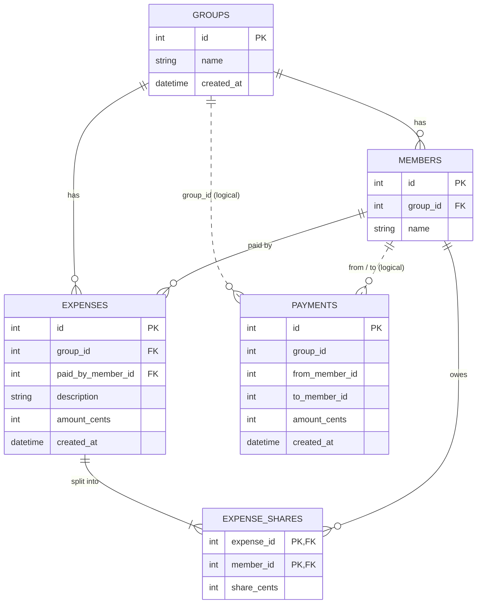

# Data model

Each service owns its own database. They share only IDs, never a foreign key across
databases. Money is stored everywhere as integer cents, never as a float.

The schema is created by the Alembic migrations, applied on startup:

- expenses-db: `services/expenses/migrations/versions/0001_create_expenses_schema.py`
- settlements-db: `services/settlements/migrations/versions/0001_create_payments.py`

## Diagram

Solid lines are real foreign keys inside one database. Dotted lines are logical links
to the other database (stored as plain integers, no foreign key).



## expenses-db (owned by expenses-service)

| Table | Columns | Rules |
| --- | --- | --- |
| `groups` | `id`, `name` (max 100), `created_at` | |
| `members` | `id`, `group_id` → groups, `name` (max 100) | Name unique within a group (`uq_members_group_name`) |
| `expenses` | `id`, `group_id` → groups, `paid_by_member_id` → members, `description` (max 200), `amount_cents`, `created_at` | `amount_cents > 0` |
| `expense_shares` | `expense_id` → expenses, `member_id` → members, `share_cents` | Primary key is (`expense_id`, `member_id`); `share_cents >= 0`; deleting an expense deletes its shares |

The shares of an expense always add up to its `amount_cents`. In an equal split, the
leftover cents go to the members with the lowest ids (1000 split 3 ways is 334/333/333).

Only `expense_shares` cascades on delete. SQL Server rejects a schema with more than one
cascade path to the same table, so the other foreign keys do not cascade.

## settlements-db (owned by settlements-service)

| Table | Columns | Rules |
| --- | --- | --- |
| `payments` | `id`, `group_id`, `from_member_id`, `to_member_id`, `amount_cents`, `created_at` | `amount_cents > 0`; `from_member_id <> to_member_id` |

A payment records a settle-up ("Ana paid Ben 20 EUR"). `group_id` and the member ids
point to expenses-db logically only.

## How a balance is derived

Balances are not stored. settlements-service computes them on request:

1. It asks expenses-service for the group's ledger: for each member, what they paid
   minus what they owe (from `expenses` and `expense_shares`).
2. It applies the recorded payments:

```
balance = (paid − owed) + payments sent − payments received
```

A positive balance means the group owes that member money; a negative one means the
member owes the group. Example: Ana owes 20 (−20). She pays Ben 20, so her balance
becomes −20 + 20 = 0, and Ben's goes from +20 to +20 − 20 = 0.

Balances in a group always sum to zero.
